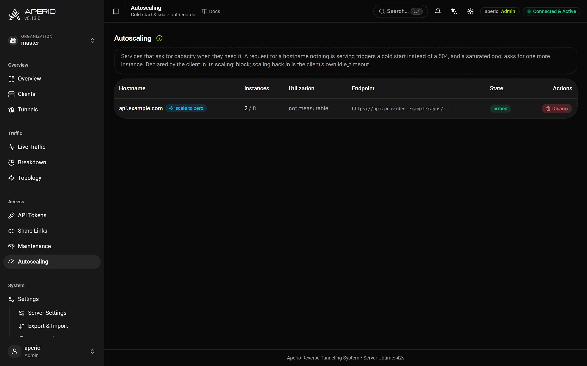

# Integrations

Three ways Aperio connects to things around it: clients signalling each other, the server asking your provider for capacity, and an edge proxy in front of the server learning hostnames that appear at runtime.

## Messages between clients

The clients of one organization can publish and subscribe over the tunnel they already hold: no port to open, and the token they connected with is the credential.

**Publish** from a script with an admin key, or from the client's local face (below):

```bash
aperio-client api publish deploy/web --payload v1.9.2
curl -X POST https://tunnel.example.com/aperio/api/publish -H "Authorization: Bearer $APERIO_SERVER_API_KEY" \
  -H 'content-type: application/json' -d '{"topic":"deploy/web","payload":"v1.9.2"}'
# → {"topic":"deploy/web","clients":3,"connections":3}
```

A payload is at most 256 KB; `payload_base64` carries binary. A topic nobody subscribes to is not an error.

**Subscribe** in the client's file, with MQTT's filters: `+` is one level, `#` the rest.

```yaml
subscribe:
  - deploy/#
  - topic: deploy/api        # run a command per message
    run: ./deploy.sh
    timeout: 120             # seconds (default 60)
    max_concurrent: 1        # runs at once; more are dropped, not queued
    env: {DEPLOY_ENV: staging}
```

A client holds at most 64 filters and receives each message once, however many connections it has. A `run:` command gets the payload on stdin and `APERIO_MESSAGE_TOPIC` and `APERIO_MESSAGE_ID` in its environment; the payload never reaches the command line. `run:` can only be written in a file, never in `APERIO_SUBSCRIBE`.

**Hand messages to an application** through a local face, loopback by default:

```yaml
messages:
  listen: 127.0.0.1:1888        # HTTP: server-sent events and POST
  mqtt_listen: 127.0.0.1:1883   # MQTT 3.1.1
```

```bash
curl -N 'http://127.0.0.1:1888/subscribe?topic=deploy%2F%23'      # payloads arrive Base64
curl -X POST 'http://127.0.0.1:1888/publish?topic=deploy%2Fweb' --data 'v1.9.2'
```

The MQTT face is a translator, not a broker: QoS 0 for subscriptions, at-least-once for a publish with QoS 1, no retained messages, no persistent sessions, and the username and password are ignored. MQTT never leaves the machine.

**Who may use which topics.** A token's `topics` list is both what it may subscribe to and what it may publish on; an empty list allows neither (`aperio-client api token create --topic 'deploy/#'`). A granted filter must cover the subscription: `deploy/#` covers `deploy/web`, not `#`. Narrowing a token's topics withdraws the subscriptions it no longer covers at once.

**Server events.** Every webhook event is also published under `$aperio/`, as the event name with underscores as levels: `$aperio/client/connected`, `$aperio/token/rotated`, `$aperio/alert/triggered`. Clients cannot publish there, a bare `#` does not match it, and a token must name it in its `topics`. Events stay inside their organization; server-wide ones reach unfenced clients only.

**Delivery.** `qos: 0` (default) sends to whoever is connected. `qos: 1` resends every 3 s until acknowledged, for up to 30 s, and the subscriber drops duplicates. Nothing is stored for a client that is away, a message never crosses an organization, and a subscriber that falls behind misses messages rather than slowing everyone; `aperio_messages_dropped_total` counts those.

The settings dialog's **Messages** pane lists subscribers and publishes test messages.

## Autoscaling

The server sees demand and supply at the same moment, so it decides *when* more capacity is needed and calls a URL you control to ask for it. Starting anything is your provider's job.

- **Cold start.** A request for a hostname nobody serves calls your endpoint and is held, up to `cold_start`, until an instance is routable.
- **Scale out.** When the pool stays saturated for `window`, it asks for one more.
- **Scale in.** When the pool stays under half the target for four windows, it asks for one fewer, never below `min` or one. Going to zero is the client's own decision, with `idle_timeout`.

Turn it on with `scaling.enabled: true` on the server, then declare it on the client:

```yaml
scaling:
  url: https://api.provider.example/apps/web/scale
  secret: ${SCALE_SECRET}    # sent as Authorization: Bearer
  min: 0
  max: 8
  cold_start: 45s
  target_utilization: 0.8
  window: 15s
  cooldown: 60s
idle_timeout: 5m
defaults:
  limits:
    concurrent_requests: 10  # one instance's capacity, which is how saturation is measured
```

The declaration is stored on the server against the hostname, so a cold start works after every instance has exited. Your endpoint receives a `POST`:

```json
{"reason": "cold_start", "hostname": "app.example.com", "path": null, "org_id": null,
 "current": 0, "desired": 1, "min": 0, "max": 8}
```

`reason` is `cold_start`, `scale_out` or `scale_in`; any `2xx` is accepted. Make it idempotent: the same call can arrive twice.

**Utilization** is requests in flight over the sum of `limits.concurrent_requests` of the routable primary clients, so a service whose clients announce no limit is never scaled out (it still cold-starts). A burst against a sleeping service makes one call; a bind waits `cooldown` between calls; failures back off, and after five in a row the record is disarmed until the client's block changes. Maintenance and a visitor the token's `allowed_ips` refuses never trigger a cold start.

**The endpoint is fenced**, since a client chose it: `https` only and public addresses only, unless `scaling.allow_http` or `scaling.allow_private`; redirects are never followed; and the server's `outbound` policy applies on top. Records belong to the organization of the token that armed them, are dropped when that token is revoked, and expire after `scaling.record_ttl` without an announcement.

`aperio-client api scaling list` shows each record with its live pool; every call is audited as `scaling_requested` or `scaling_failed`.



## Behind a dynamic edge proxy

When Traefik or Caddy terminates TLS in front of the server, it has to learn hostnames that appear when a client connects. Without a proxy, the server does the same by itself: `tls.acme.on_demand` obtains a certificate for a hostname a client serves the first time it is reached ([In front of the server](deployment.md#in-front-of-the-server)).

**One wildcard domain** needs nothing: give the edge one wildcard route and one wildcard certificate, which is the natural fit for random subdomains.

```yaml
# docker-compose.yml labels on the aperio service
- "traefik.http.routers.aperio.rule=HostRegexp(`^.+\\.example\\.com$`)"
- "traefik.http.routers.aperio.tls.domains[0].sans=*.example.com"
```

**Any other hostname**, a customer's domain pointed at you, needs a route and a certificate each. Set `edge.token` on the server to turn on two read-only endpoints (`edge.service_url` and friends shape the Traefik output); the token goes in `Authorization: Bearer` or `?token=`.

Caddy asks before issuing a certificate, so a hostname nobody serves never reaches ACME:

```
{
  on_demand_tls {
    ask http://aperio:8080/aperio/api/edge/ask?token=YOUR_EDGE_TOKEN
  }
}
https:// {
  tls { on_demand }
  reverse_proxy aperio:8080
}
```

Traefik polls a dynamic configuration with one router per served hostname:

```yaml
# traefik.yml (static configuration, one restart once)
providers:
  http:
    endpoint: "http://aperio:8080/aperio/api/edge/traefik"
    pollInterval: 10s
    headers:
      Authorization: "Bearer YOUR_EDGE_TOKEN"
```

A hostname counts as served while a client is connected for it, even with its backend failing, so a route is not withdrawn mid-incident. `edge.include_offline` also publishes hostnames a token permits but nobody serves yet; in a multi-tenant server that lets a tenant spend your ACME rate limit, so pair it with [hostname fences](tokens-and-organizations.md#fences-panels-and-quotas).

## Examples

[`messaging`](examples/messaging/), [`mqtt`](examples/mqtt/), [`autoscaling`](examples/autoscaling/).
