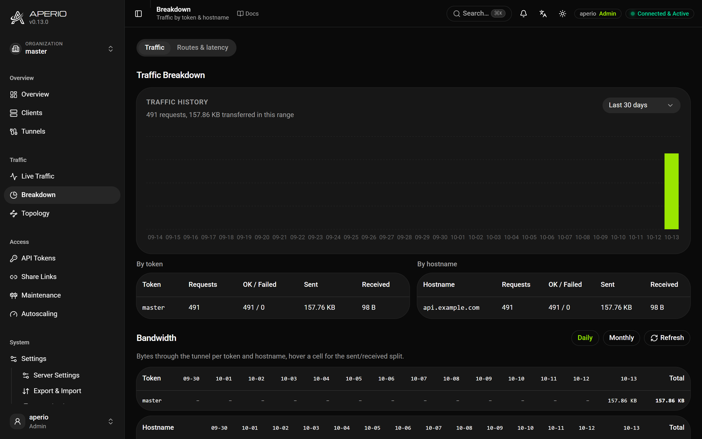

# Observability

What the server tells you about itself: metrics, traces, alerts, logs, the audit trail and webhooks.

## Metrics

`metrics.enabled: true` serves Prometheus metrics at `/aperio/metrics`. It always needs a token: `metrics.token`, or one generated on the first start and kept in the data directory.

```yaml
# prometheus.yml
scrape_configs:
  - job_name: aperio
    metrics_path: /aperio/metrics
    params: { token: ["<metrics-token>"] }
    static_configs: [{ targets: ["tunnel.example.com"] }]
```

| Family | Metrics |
| --- | --- |
| Requests | `aperio_requests_total`, `_success_total`, `_failed_total`, `aperio_request_duration_seconds` (histogram, 5 ms to 30 s), `aperio_bytes_transferred_total`, `aperio_pending_requests` |
| Clients | `aperio_connected_clients`, `aperio_client_requests_total{client_id, service}` |
| Tenants | `aperio_token_*_total{token}` and `aperio_hostname_*_total{hostname}`: requests, failures, bytes each way, at most 200 labels each |
| Refusals | `aperio_rate_limited_total{limit}`, one series per [limit](traffic.md#limits-and-backpressure) |
| Messages | `aperio_messages_published_total`, `_delivered_total`, `_dropped_total` (alert on it), `_resent_total`, `_abandoned_total` |
| Public listeners | `aperio_expose_sessions`, `aperio_expose_bytes_total`, `aperio_expose_drops_total`, and the rest of `aperio_expose_*` |

`client_id` is the id the client configured, stable across reconnects; parallel connections of one service are summed into one series. `metrics_labels: {env: prod}` on a client service adds static labels to its series, at most 8, validated by the server.



## Traces

`otel.enabled: true` exports a span per proxied request over OTLP, with a child per stage:

```yaml
otel:
  enabled: true
  endpoint: http://otel-collector:4318
  protocol: http          # or grpc; unset, port 4317 means grpc
  sample_rate: 0.01       # 1.0 traces every request
```

An inbound W3C `traceparent` becomes the span's parent, and the trace context is forwarded to the backend, so visitor, Aperio and backend form one trace. `sample_rate` defaults to `1.0`, right for staging and expensive for a busy server.

**The OTel bridge** carries a client's own telemetry over its tunnel, for an edge host whose only way out is the tunnel. Turn on `otel.bridge` on the server and give the token `allow_otel`; the client then runs an OTLP receiver on loopback:

```yaml
otel_bridge:
  listen: 127.0.0.1:4318   # OTEL_EXPORTER_OTLP_ENDPOINT=http://127.0.0.1:4318
```

The server stamps each export with the token and organization it came from and forwards it to its own collector. Protobuf only; a full queue drops exports rather than blocking the application.

## Alerts

```yaml
alerts:
  error_rate: 0.05       # 5% of requests failing
  window: 5m
  min_requests: 20
  client_down: 2m        # a known service down this long
```

Each episode fires `alert_triggered` once and `alert_resolved` when it clears, through webhooks, the `$aperio/` topics and the audit log.

### Your own rules

```yaml
alerts:
  rules:
    - name: disk_filling       # becomes the alert's kind
      metric: store_bytes
      above: 536870912
      for: 300                 # seconds, both to fire and to resolve
    - name: no_clients
      metric: connected_clients
      below: 1
      for: 120
```

`metric` is `connected_clients`, `pending_requests`, `store_bytes` or `rss_bytes` (Linux only). A malformed rule is refused when saved. For anything richer, alert on the Prometheus metrics.

## Logs

**Access log.** Every proxied request is a structured `aperio_access` event on stdout: `request_id`, `method`, `uri` (query stripped), `status`, `duration_ms`, `host`, `client_id`, `token`, or `error` for a failure. `logging.access_log` also appends it as JSON lines to a file, for Loki or ClickHouse; `logging.sample_rate` thins successful requests and `logging.access_events: false` drops them. A TCP or UDP relay logs one `relay_closed` line per connection with its duration and bytes.

`GET /aperio/api/logs` returns the last 100 requests, filtered by `status` (`404` or `5xx`), `method` and `path`.

**What clients report.** Each heartbeat carries the connection's round-trip time and jitter, its reconnect count, and on Linux the process's CPU and memory, shown on the clients table and in `/aperio/api/stats`. Round-trip time is what tells a slow tunnel from a slow backend.

## Audit log

Administrative and security events are appended to `audit.jsonl` in the data directory, each with the actor, their address, the organization and details, hash-chained so tampering shows: `aperio-server audit verify`. It rotates at `audit.max_size` (10 MB), keeping `audit.max_files` (3).

The dashboard's **Audit Log** shows the latest 200 of the caller's organization. `GET /aperio/api/audit` searches the whole log with `event` (exact), `actor`, `q` (substring), `from`, `to` and `limit` (up to 5000); `/aperio/api/export/audit.csv` returns the same as CSV. The organization fence applies before any filter.

| Group | Events |
| --- | --- |
| Sign-in | `login_success`, `login_failed`, `login_lockout`, `oidc_login_success`, `oidc_login_denied`, `sso_login_success`, `sso_login_denied`, `passkey_registered`, `passkey_deleted`, `totp_enabled`, `totp_disabled`, `totp_admin_reset`, `session_revoked`, `sessions_cleared` |
| Tokens and keys | `token_created`, `token_updated`, `token_revoked`, `token_rotated`, `token_refreshed`, `token_expiring`, `token_new_ip`, `token_pin_mismatch`, `canary_tripped`, `admin_key_created`, `admin_key_revoked`, `share_created` |
| Clients and tunnels | `client_connected`, `client_disconnected`, `client_draining`, `client_enabled`, `client_disabled`, `tunnel_created`, `tunnel_deleted`, `tunnel_denied`, `tcp_stream_opened`, `udp_stream_opened`, `expose_stream_opened` |
| Public listeners | `expose_changed`, `expose_failed`, `expose_runtime`, `expose_policy_changed` |
| Users and organizations | `user_created`, `user_updated`, `user_deleted`, `user_grant_added`, `user_grant_removed`, `grants_widened_on_upgrade`, `org_created`, `org_renamed`, `org_deleted`, `org_hostnames_set`, `org_panel_set`, `org_quota_updated`, `org_oidc_updated` |
| Configuration | `settings_updated`, `settings_security_changed`, `maintenance_on`, `maintenance_off`, `cache_purged`, `tls_certificate_issued`, `tls_certificate_failed` |
| Data | `export_created`, `import_applied`, `db_backup`, `data_purged`, `retention_pruned`, `disk_pruned`, `request_replayed` |
| Alerts and scaling | `alert_triggered`, `alert_resolved`, `disk_usage_warning`, `scaling_requested`, `scaling_failed`, `scaling_disarmed` |
| Webhooks and messages | `webhook_created`, `webhook_deleted`, `webhook_tested`, `webhook_refired`, `webhook_redelivered`, `message_published` |

## Webhooks

A webhook (dashboard, or `aperio-client api webhook create`) receives the events it subscribes to (`*` for all) as JSON `POST`s, only for its own organization:

```json
{ "event": "client_connected", "timestamp": "2026-07-06T15:16:37+03:00", "data": { "client_id": "...", "token": "tenant_a" } }
```

The events are: `client_connected`, `client_disconnected`, `client_draining`, `token_created`, `token_revoked`, `token_rotated`, `token_expiring`, `token_new_ip`, `token_pin_mismatch`, `canary_tripped`, `tunnel_created`, `tunnel_deleted`, `share_created`, `maintenance_on`, `maintenance_off`, `settings_updated`, `import_applied`, `user_created`, `alert_triggered`, `alert_resolved`, `scaling_requested`, `org_usage`, `disk_usage_warning`, `db_backup` and `disk_pruned`. The same events are published on [`$aperio/` topics](integrations.md#messages-between-clients).

- **Delivery.** A transport error, `5xx` or `429` is retried at 1, 5, 25 and 60 seconds (`webhooks.retry_schedule`); other `4xx` are final. The last 500 outcomes, with their payloads, are in the delivery log, and any can be redelivered.
- **Testing.** *Test* sends one `webhook_test` event through the real path and shows what the receiver answered.
- **Formats.** `slack`, `discord` or `teams` deliver a coloured card to that service's incoming-webhook URL instead of raw JSON.
- **Signing.** With a secret (16 to 128 characters), each delivery carries `X-Aperio-Timestamp` and `X-Aperio-Signature: sha256=<HMAC of "<timestamp>.<body>">`. Verify it in constant time and reject old timestamps.
- **Destinations** are checked against the server's [outbound policy](reference.md#outbound), when one is set, at creation and at every delivery.

## Statistics

Lifetime counters and daily, weekly, monthly and yearly buckets are kept in the database, per token and per hostname as well, and survive restarts. `GET /aperio/api/stats/history` and `/aperio/api/export/traffic.csv` return them; the dashboard's **Breakdown** draws them. How long they are kept is under [The server's data](operations.md#the-servers-data).

## Examples

[`observability`](examples/observability/).
