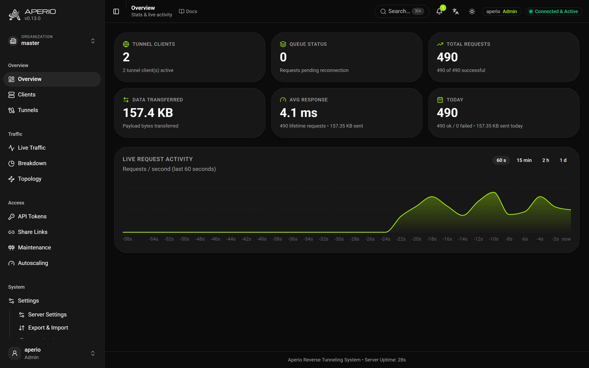
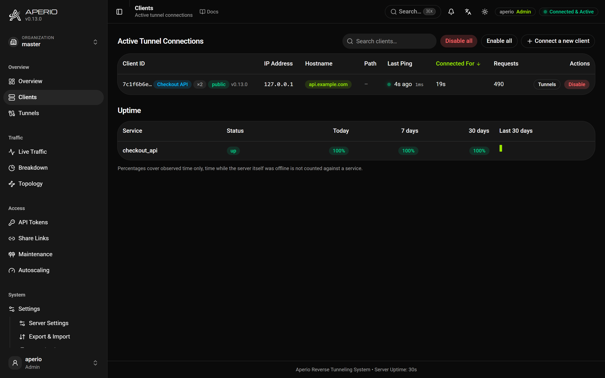
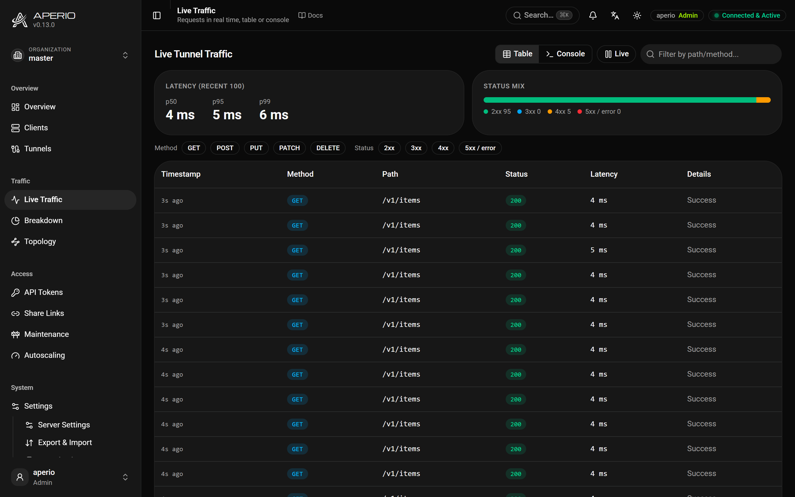
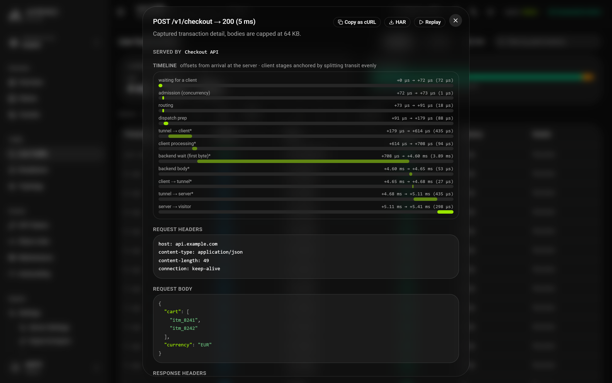
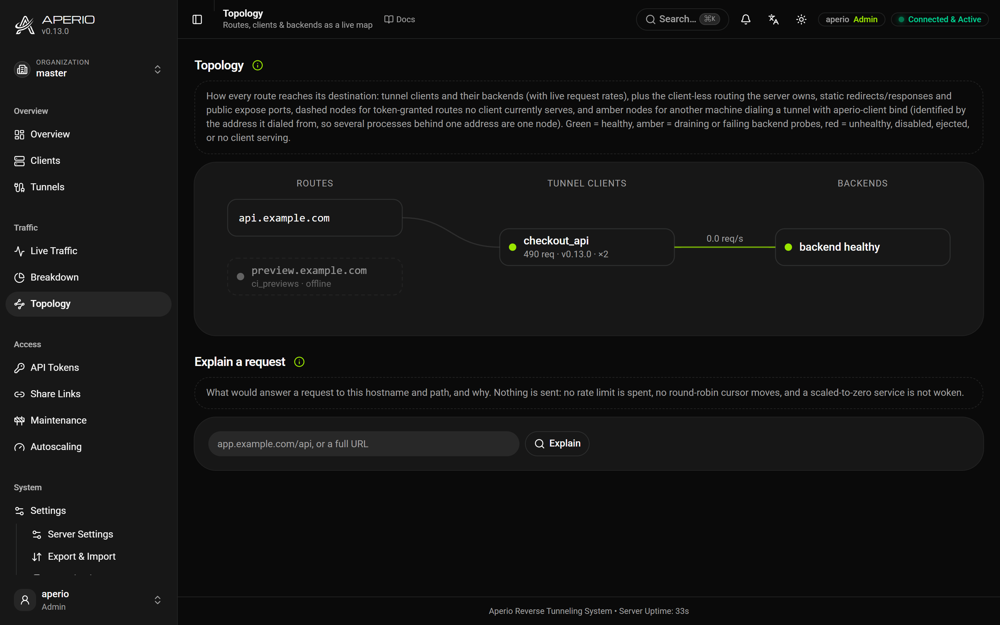
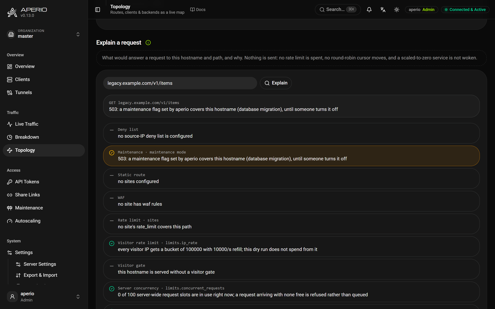
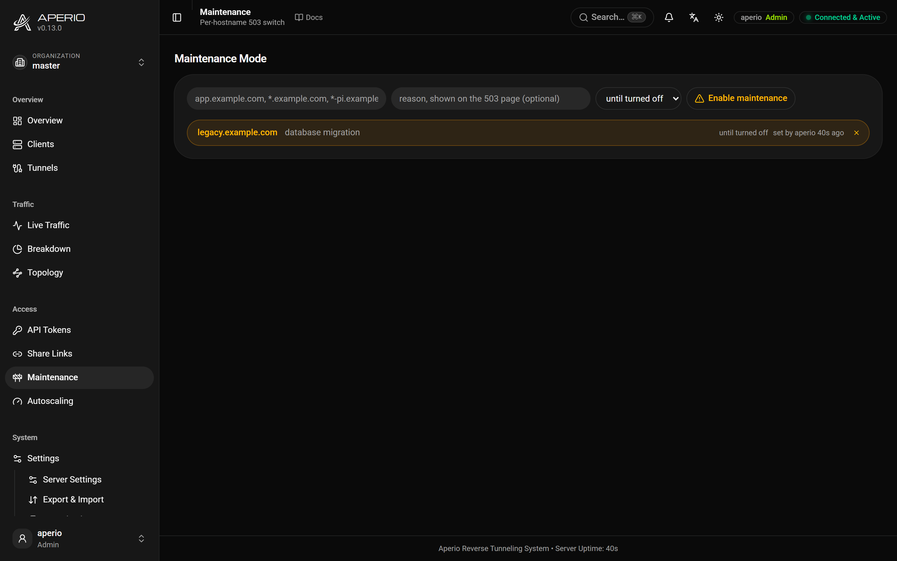
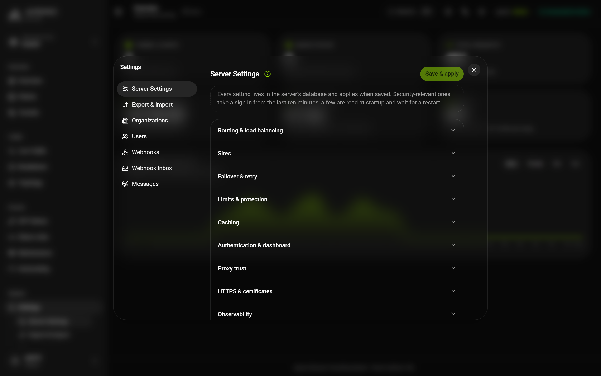

# Operations

Running a server day to day: the dashboard, the admin API and its command line, maintenance, and the data the server keeps.

## The dashboard

The dashboard is at `/aperio` on every hostname the server answers, compiled into the server binary. Sign in as `aperio` with the master token, or as a [named user](tokens-and-organizations.md#signing-in-to-the-dashboard). Each page header links to its documentation, and `Ctrl`/`⌘`+`K` searches pages and settings, with each setting's current value.

### Live overview



Connected clients, request rate, latency and today's traffic, pushed over a server-sent event stream (`/aperio/api/stream`) and falling back to polling. The activity chart covers the last minute from the browser, or 15 minutes, 2 hours or a day from the server's own history. The **bell** carries the server's events as they happen, the same ones webhooks receive, fenced to the caller's organization.

### Clients



Every connection with its hostname, health, last heartbeat, version and tier, and a `BACKEND DOWN` badge while its health probe fails. Clicking a row shows the connection's **effective configuration** as yaml: what the client announced and what the server applied, with every value that differs from what was written (a divided bandwidth, a clamped pool, a cache the server ignores) marked and explained. The **kill switch** takes a client out of routing without disconnecting it. The **Uptime** panel below gives each service's up, degraded and down time for today, 7 and 30 days, kept for 60 days.

### Live traffic



Every proxied request as it completes, with latency percentiles, a status mix and filters. **Console** shows the same feed as one line per request, like `tail -f`.

**The inspector.** Clicking a request shows its headers, body previews (64 KB each way) and a timeline of every stage, from the server to the client and back. It can be **replayed** through the tunnel, copied as `curl`, or saved as HAR. Credential headers and secret-looking fields are masked unless `inspector.redact` is off; a replay still sends the original. The last 50 captures are kept, shared fairly between organizations.



**Webhook inbox.** A service with `webhook_inbox: true` has every `POST` it receives stored (the newest 500), so an event that arrived while its backend was down can be **re-fired** later.

### Topology



A live map from routes to clients to backends, coloured by health. It also shows what serves without a client (sites that answer by themselves, public listeners), hostnames a token grants that nobody serves, and which machines bind a client's tunnels.

**Explain a request** walks the decisions the proxy would make for a hostname and path, without sending anything, and marks the one that decides: maintenance, a site's own answer, the firewall, a rate limit, the gate, client selection, the fallback. When nothing serves the route it names the clients that could have, and why they did not. `aperio-client api explain app.example.com --path /api` does the same.



### Breakdown

Traffic history, top tokens and hostnames, bandwidth per day or month, per-route status trends for the last 30 minutes, the slowest endpoints by p95, and per-stage latencies with an anomaly badge when a stage jumps. The server admin's **Server Health** page adds the process's own memory, store size and cache statistics.

### Maintenance



A maintenance flag makes a hostname answer `503` while its clients stay connected. It takes an exact hostname, a `*.example.com` subtree, a `*-pi.example.com` label, or `*` for every hostname (master only). A flag carries a **reason**, shown on the page, and optionally a duration after which it lifts by itself, which also makes `Retry-After` truthful. Flags live in memory and a restart clears them; a recurring window belongs on a [site](configuration.md#sites) instead. An organization may flag only hostnames inside its fence that no other organization is serving.

```bash
aperio-client api maintenance on '*.example.com' --reason "database migration" --ttl 1800
```

### Settings



Settings open as a dialog over the current page, with panes for **Server Settings**, **Organizations**, **Users** (with admin keys and live sessions), **Webhooks**, **Webhook Inbox**, **Messages** and **Export & Import**. The server settings pane is built from the settings schema, so every setting is there, grouped by what it governs, with the rarely used ones last. A security setting is marked and asks for a recent sign-in; a restart-only one shows **restart pending** after it is saved; a secret shows as stored and is kept unless replaced. See [Changing a setting](configuration.md#changing-a-setting).

### Tools

The **Audit Log**, the **API Explorer** (the server's OpenAPI document with a try-it form that uses your session), and the **Config Builder**, which writes an `aperio.yaml` or a first-start document from the schema the server serves, and can open an existing one without losing anything it does not understand.

## The admin API from the command line

Everything the dashboard does is an API call under `/aperio/api/`, described by `GET /aperio/api/openapi.json` and listed in the [Reference](reference.md#http-endpoints). `aperio-client api` (also `admin`) makes one call and prints the JSON answer; a failure exits non-zero, so scripts stop on it.

```bash
# Sign in once; a key for this machine is kept in ~/.aperio/profiles.yaml.
printf '%s' "$APERIO_SERVER_TOKEN" | aperio-client login --server-url https://tunnel.example.com --password -
aperio-client api token list
aperio-client profile use staging
aperio-client logout          # forgets the profile and revokes its key
```

`login` mints a server-admin key by default; `--role` and `--org` narrow it and `--expire` limits it. A named user signs in with `--user alice --password -`, adding `--totp` for a second factor. Someone handed a key keeps it with `aperio-client login --server-url URL --key -`. A key given as `--server-api-key`, `APERIO_SERVER_API_KEY` or `server.api_key` wins over the profile, and a profile is sent only to its own server. The first key on a new server comes from its host: `aperio-server admin create-key --name ci`.

A key acts in one organization with one role, like a user: reads need `viewer`, changes `operator`, users, settings and keys `admin`, and server-wide commands the server admin. Without a key, only `api tunnel create` and `delete` work, with the master token.

| Group | Commands |
| --- | --- |
| Links and tokens | `share`, `token list\|create\|update\|rotate\|revoke\|refresh`, `tunnel create\|delete` |
| Live state | `client enable\|disable\|config`, `maintenance list\|on\|off`, `cache stats\|purge` |
| People and tenants | `user ...`, `org ...`, `admin-key ...` |
| Events | `webhook list\|create\|delete\|deliveries\|redeliver\|test`, `inbox ...`, `publish`, `subscribers` |
| Reports | `stats`, `history`, `uptime`, `logs`, `topology`, `slow-endpoints`, `bandwidth`, `route-trends`, `stage-stats`, `self-health`, `activity`, `explain`, `audit list\|verify`, `audit-csv`, `traffic-csv`, `request show\|replay` |
| Server | `settings get\|set`, `export`, `import`, `purge`, `scaling list\|disarm`, `expose ...`, `edge-traefik`, `edge-ask`, `schema`, `openapi`, `health` |

`aperio-client api <group> --help` lists every flag. Durations take `45s`, `30m`, `2h`, `1d`, `2w` or `never`. `--hostname` and `--path` mean what they mean for a service. A password given as `-` is read from stdin. `aperio-client completions zsh|bash|fish|elvish|powershell` prints shell completion.

```bash
TUNNEL="$(aperio-client api tunnel create --name "pr-$PR" --expire 2h)"
export APERIO_SERVER_TOKEN="$(printf '%s' "$TUNNEL" | jq -r .token)"
aperio-client api cache purge --hostname app.example.com --path-prefix /assets/
```

## The server's data

Everything lives in `APERIO_DATA_DIR`: `aperio.db` (SQLite: settings, tokens, users, statistics, sessions), `audit.jsonl`, and the metrics token.

**Export and import.** `GET /aperio/api/export` (`aperio-client api export`) writes a JSON dump: by default the sections that rebuild a deployment (settings, tokens, webhooks, users, organizations, scaling, public listeners), and on request `statistics`, `uptime`, `activity`, `inbox` and `admin_keys`. Without `organizations`, only master's rows travel. `POST /aperio/api/import` replaces each section the document contains and leaves the rest. Both take the server admin. Sessions and the audit log never travel.

**Backups.** `backup.interval` and `backup.dir` write snapshots of the database, `backup.keep` of them, encrypted when `APERIO_BACKUP_KEY` is set (`aperio-server backup decrypt` reads one back). A snapshot is the whole database; an export is a portable, reviewable document.

**Retention.** `retention.captures`, `retention.access_log`, `retention.audit` and `retention.stats` bound how long each kind of record is kept; unset keeps it. A pruner runs at start and hourly and audits what it removed. `retention.db_max_size` caps the database: at 90% it warns (`disk_usage_warning`), past it the oldest low-priority data is pruned and the file vacuumed. Statistics keep 60 days, 26 weeks, 24 months and 10 years of buckets by themselves.

**Erasure.** `POST /aperio/api/purge` (`aperio-client api purge --hostname app.example.com`, or `--token-name`, `--ip`) deletes the traffic records matching a hostname, token or visitor address: the live log, inspector captures, statistics aggregates, cache entries and access-log lines. Visitor addresses are not stored in logs or statistics to begin with. Each purge is audited as `data_purged`.

## Examples

[`dashboard`](examples/dashboard/).
