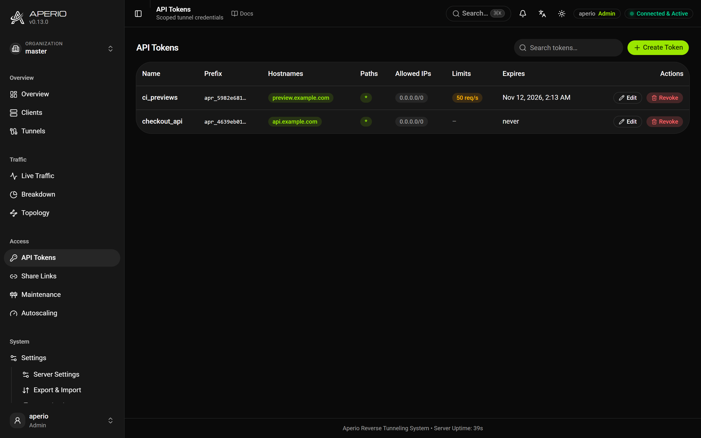

# Tokens & Authentication

Aperio has several independent auth layers. They answer different questions, *who may open a tunnel*, *who may visit the proxied site*, and *who may administer the server*, and you enable only the ones you need.

> **Configuration:** Server settings live in the server's database and are changed from the dashboard (**Settings**), with `PUT /aperio/api/settings`, or in a first-start document (`APERIO_INIT_FILE`); they are written as paths such as `cache.enabled`. Client settings go in `aperio.yaml`. See [Configuration](configuration.md#server-settings).

## The master token

`APERIO_SERVER_TOKEN` is root: it authenticates tunnel clients, logs into the dashboard (user `aperio`), and authorizes the ephemeral-tunnel API. Treat it accordingly, front the server with TLS so it never travels in plaintext, and prefer dynamic tokens for day-to-day clients.

## Dynamic tokens



Minted from the dashboard's *API Tokens* section, each token is scoped and revocable:

- **Hostnames**, which hostname binds the token may claim (`*` = any). Specific entries are **auto-bound** on connect, so the client doesn't even need `--host`.
- **Paths**, which path binds it may claim.
- **Allowed IPs**, source IPs/CIDRs that may connect with this token.
- **Lifetime**, optional TTL; expired tokens are rejected at connect time. As an early-warning system, a `token_expiring` webhook/audit event fires once a token's remaining lifetime drops under `security.token_expiry_warning` (default 24 h), and the dashboard tokens table shows an "expiring soon" badge, refresh or re-issue before anything breaks.
- **Rate limit**, optional requests/second cap for the traffic served through this token; excess requests answer `429`.
- **Daily quota**, optional bytes/day cap (request + response payload), answering `429` once exhausted until local midnight (in-memory tracking; a restart resets the day's usage).
- **Parallel connections** (`max_connections`), optional ceiling on the `connections:` a client using this token may open for one service. It can only lower the server's `max_connections_per_service`, never raise it: the effective number is the smaller of the two, announced to the client on connect so it opens that many instead of finding out by being closed. Empty = whatever the server allows.
- **May bind tunnels** (`allow_bind`, off by default), whether this token may bind the [tunnels](emergency-tunnels.md) declared by *other* clients in its organization. Without it a binder needs the very credential the declaring client connected with, which is also the credential that publishes services as that client: reaching a database for ten minutes meant handing over the ability to serve as them. It never crosses an organization; only the master token does that.
- **May export telemetry** (`allow_otel`, off by default), whether this token may send OpenTelemetry exports through the server's [OTel bridge](observability.md#the-otel-bridge-telemetry-from-the-edge). Two switches have to line up: the server's `otel_bridge` says forwarding happens at all, this says which clients may ask for it. They are different questions, one about the deployment and one about the tenant, and answering both with one setting would mean turning the bridge on for an edge host turns it on for every token on the server.

A client declaring a bind its token doesn't permit gets the declaration ignored (and logged). Tokens can be edited in place, scope, IPs, expiry change while the secret stays the same, or revoked, which immediately drops the tunnel connections using the token and rejects reconnects.

Secrets are stored as SHA-256 hashes in `APERIO_DATA_DIR/aperio.db` (SQLite) and shown exactly once at creation.

### Short-lived tokens & refresh

A token created with a lifetime can slide its own expiry forward, mint it with a short TTL and let the holder keep it alive only while it is actually in use:

```bash
# from anywhere holding the token, e.g. the CI job that uses it
curl -X POST -H "Authorization: Bearer $APERIO_TOKEN" https://tunnel.example.com/aperio/api/tokens/refresh
# → { "status": "ok", "id": "…", "expires_at": 1780000000 }
```

The endpoint authenticates with the token secret itself (no dashboard session needed), so a CI job or a long-running client can refresh on a timer. Each refresh resets the expiry to *now + the token's current TTL*, the value `token update --expire` last wrote, not necessarily the TTL it was created with. Never-expiring tokens are not refreshable, an expired token cannot resurrect itself, and each refresh writes a `token_refreshed` audit event.

### Rotation with a grace period

Rotation replaces a token's **secret** without touching its identity, permissions, limits, expiry, and every reference to the token id stay as they are. The old secret keeps authenticating for the requested grace window, so running clients and CI jobs can migrate to the new secret without a hard cutover:

```bash
# from anywhere, against the server's admin API
curl -X POST -b "$SESSION" -H 'Content-Type: application/json' \
  --data '{"grace_seconds": 86400}' \
  https://tunnel.example.com/aperio/api/tokens/<id>/rotate
# → { "id": "…", "name": "…", "token": "apr_…new…", "prev_expires_at": 1780086400, … }
```

The new secret is returned exactly once (like creation). `grace_seconds: 0` (or omitting it) cuts the old secret off immediately, the right move when a secret has leaked; combine with the revoke endpoint's behavior in mind: rotation does **not** drop live tunnel connections, it only controls which secrets future connects may present. Only the most recent previous secret is kept: rotating twice inside one grace window invalidates the oldest secret. Each rotation writes a `token_rotated` audit event and emits a `token_rotated` webhook event.

## Protecting proxied traffic

A gate is written as `access`, in one grammar wherever it appears: the server's `access` for every route nothing else declares, a site's `access` for one hostname, and a client service's `access:` for its own traffic. It is `public`, or it names a **method**. Six exist: `none` (deliberately open), `basic` (a `user:password` login), `bearer` (an opaque secret in a header, for callers with no browser), `jwt` (a token the visitor already holds, verified against its issuer's keys), `forward` (ask an endpoint you run, on the server's network or, with `via: client`, on the client's) and `aperio` (this server's own sign-in, for a route that should ask for a dashboard session rather than a password of its own). [Configuration](configuration.md#visitor-authentication) is the reference; the two below are what most deployments start with.

- **Visitor password**, `access: {method: basic, users: "user:password"}` in the server's settings shows a login form to every visitor of a route nothing else declares.

  **It is a key to the site and not to Aperio.** The session it creates reaches every proxied hostname, so somebody who signs in on one is not asked again on the next, and it opens nothing on the dashboard or its API. To administer Aperio, use the master token or a named user.
- **Single sign-on**, `method: sso` sends a visitor to an identity provider (Google, Keycloak, Authentik, ...), Cloudflare-Access style:

  ```yaml
  # settings
  access:
    method: sso
    issuer: https://accounts.google.com
    client_id: xxxx.apps.googleusercontent.com
    client_secret: ${SSO_CLIENT_SECRET}
    allowed_emails: [me@corp.com, "*@team.example.com"]
  ```

  After the sign-in, the verified email (fetched from the issuer's `userinfo` endpoint over TLS) is checked against `allowed_emails`: exact addresses, `*@domain`, or `*`. It is the **visitor's** sign-in: what it mints is a session for the hostname they signed in on, which opens the site and nothing of Aperio, and the email is checked again on every request, so narrowing the list takes effect at once. Register `https://<hostname>/aperio/sso/callback` at the provider for each hostname the gate covers. Written on a [site](configuration.md#sites), it covers that hostname alone; a client cannot declare it, since the provider and its secret are the operator's. Sign-ins and refusals are audit-logged as `sso_login_success` and `sso_login_denied`.

  The dashboard's own OIDC sign-in (`oidc.*`) is a different thing: it lets **operators** in, with the roles their records give them, and it gates no visitor by being configured. A route that should ask for the dashboard sign-in says `access: {method: aperio}`.

A client can opt its own service out of the gate by declaring itself **public** (`--access public`, yaml `access: public`, or `APERIO_ACCESS=public`), useful when one Aperio server fronts both protected internal tools and a public site. Two safety rules apply: the client's token must carry the *may publish public services* permission (off by default; master always may), and a route has one policy, so a client that declares something else for a route another client already serves is not routed there at all (see [One route, one policy](#one-route-one-policy)).

### Client-set visitor password (per service)

Instead of opting out, a client can supply its **own** gate for its service: `access:` on its `services:` entry (or under `defaults:`, `--access`, `APERIO_ACCESS`), a method block such as `{method: basic, users: "user:password"}` or a list of them, any of which admits. A client may write any method, with one rule: a `forward` must say `via: client`, so the endpoint is asked over the tunnel on the client's own network, since the server never dials a URL a client chose. The server then gates that service with what the client declared, whatever the server's own `access` says:

- It reuses the same *may publish public services* token permission (master always may); a client without it has its `access` ignored, logged on the server and told to the client.
- When set, it **supersedes** the server's own `access` *for that service*: the server's credentials no longer work there, only the client's, plus the always-valid `aperio:<master token>`.
- A successful login with client credentials yields a session **scoped to that hostname only**, it never unlocks the dashboard or another host. (If several path-bound services share one hostname with *different* `access`, a login covers the whole hostname; give each its own hostname to isolate them.)
- The server operator keeps the last word per hostname with a **site's `access`**: written on a site in the server's settings, it decides for that hostname whatever the clients serving it declare, and a client overruled this way is told so in its own log. See [Sites](configuration.md#sites).
- Anything beyond `basic` is **agreed with the server on the handshake** before it is declared. A server that does not accept the method means the client does not serve that service at all, saying which side is too old, rather than connecting under a gate the server was never told about.

### One route, one policy

Several clients may serve the same route, the same hostname and path, as replicas of one service do. They have to say the same thing about it: the same `access`, the same `allowed_ips` and the same `denied`. A client that declares something different from a client already serving the route is **not routed there**: the server keeps it out of the pool, logs why, and tells the client in its own log, naming the setting that differs and who already serves the route. It is asked again on every heartbeat, so it serves as soon as the two agree, or as soon as the other one leaves. Where a [site](configuration.md#sites) decides who reaches the route, its `access` is the answer and only `allowed_ips` and `denied` have to agree.

This replaces three different rules that used to be resolved again on every request, `public` only when every client said so, a gate only when every client declared the same one, and each client filtering by its own `allowed_ips`, whose answer depended on who happened to be connected at that moment.

To let specific people through a protected site *without* an account, use [Share Links](share-links.md).

## Dashboard access

The dashboard password is the master token. To let someone in without handing them root, create a named dashboard user (Users page) or give them their own [organization](organizations.md) rather than sharing a second server-wide password; `dashboard.enabled: false` disables the dashboard entirely. The Prometheus endpoint always requires its own token (`metrics.token`).

Named dashboard users are created on the *Users* page and carry a list of grants, one `(organization, role)` pair each, with `viewer`, `operator` or `admin` in every organization they reach. The built-in `aperio` admin, the master token, is the server admin, `*: admin`: Admin in every organization, and the only role that reaches the server-wide surfaces. A named user or admin key granted `*: admin` is one too; Admin of master administers master and nothing more. An OIDC login is matched to a dashboard user record by email and holds exactly that record's grants; an email with no record gets `oidc.default_grants`, which is empty unless configured, and is refused until something is granted to it. See [Organizations](organizations.md#oidc-identity-is-the-providers-authorization-is-aperios).

**The two planes are separate.** Signing in with a visitor password creates a session for viewing sites, not for administering Aperio, and only the master token, a named user, a passkey or OIDC create a dashboard session. A dashboard session does still carry its holder past the visitor gate, fenced to the hostnames their own [organization](organizations.md) serves.

## Organizations

Tokens and users can be grouped into **organizations** so one server hosts several isolated tenants: a token belongs to the organization it was minted under, the client that authenticates with it is attributed there, and members of one organization never see another's clients, tokens, users, traffic, or stats. The built-in `aperio` admin is the server admin, Admin of every organization, and can switch between them, and a named user can be granted several organizations with a role in each and switch the same way; everything created without an organization belongs to the implicit **master** organization. See [Organizations (Multi-Tenancy)](organizations.md) for the full model.

## Defense in depth

The client deliberately does not fully trust the server: it only connects to its configured HTTP/TCP targets (SSRF guards), caps tunnel message sizes, bounds decompression output, and enforces its own concurrency limit. All secret comparisons are constant-time; session cookies are `HttpOnly` + `SameSite=Lax`.

## Token pinning (trust-on-first-use)

`security.token_pinning: true` binds each dynamic token to a single client device. On the first connection, the server pins the device key the client announces; any later connection presenting a **different** (or missing) key for that token is rejected, and a `token_pin_mismatch` audit + webhook event fires. This means a token leaked into a CI log or a config dump cannot be replayed from another machine without also stealing that machine's device key.

A client reading a config file announces a device key with nothing configured: it generates one on its first run and keeps it beside its `client_id`, under `~/.aperio/clients/`, so a server that turns pinning on recognizes the machine. A client with no config file (one configured by the environment alone, as a container usually is) announces none unless told, since a key it could not keep would change at every start and pin the token to a machine that forgets itself. Either way it can be given:

- `APERIO_DEVICE_KEY`, an explicit value you manage (and copy to another box yourself if you deliberately move the token there), which is what a container sets.
- `APERIO_DEVICE_KEY_FILE`, a file path; the client reads it, generating and persisting a fresh random key there on first run.

Two consequences follow from the single-device binding, and are intentional:

- **One token, one client.** While pinning is on, a pinned token serves from exactly the device that pinned it. Moving the token to a new machine is a manual step, carry the device key, or **rotate** the token, which clears the pin so the next client re-pins.
- **Missing keys are rejected too.** Once a token is pinned, a connection that announces no device key is refused, so an attacker cannot simply omit it.

Pinning provides replay rejection without a full PKI; it is not transport encryption (put Aperio behind TLS for confidentiality).

## From the command line

The whole token lifecycle is scriptable: `aperio-client api token create|list|update|rotate|revoke`, authenticated with an admin key. See [Admin API from the CLI](cli-api.md).

## Runnable examples

Copy-and-adapt config pairs for this topic:

- [`oidc`](examples/oidc/): SSO login in front
- [`visitor_auth`](examples/visitor_auth/): visitor login gates
- [`allowed_ips`](examples/allowed_ips/): per-service visitor IP allowlists
