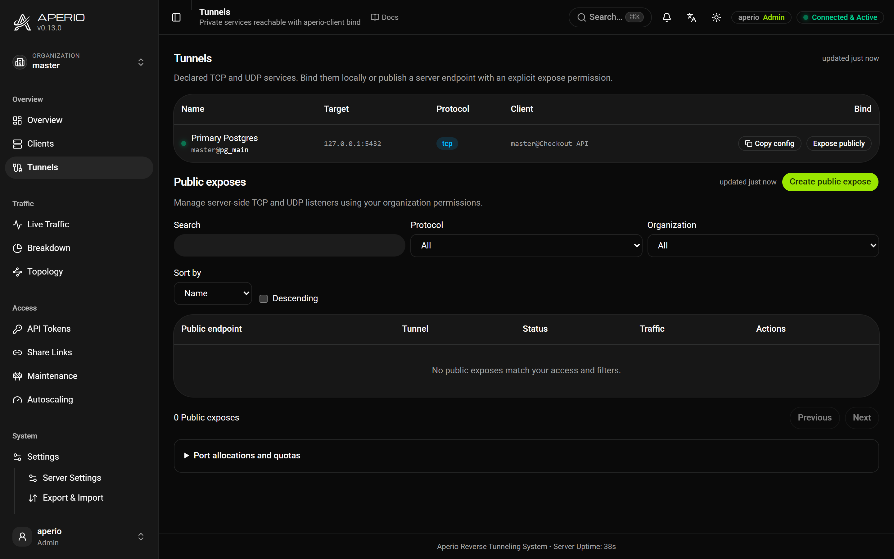

# Tunnels

Raw TCP and UDP services that are not routed as websites: a database, an SSH daemon, a DNS resolver. A client declares them; another client binds one to a local port, or the server opens a public port for it. It is a narrow path, built for reaching a private service when you need to, not for high load.

The same API also mints short-lived preview hostnames, covered at the end under [Preview environments](#preview-environments).

## Declaring a tunnel

On the machine next to the private service:

```yaml
tunnels:
  mongo:
    target: 127.0.0.1:27017
  ssh:
    target: 127.0.0.1:22
  dns:
    target: 127.0.0.1:53
    protocol: tcp/udp      # tcp (default), udp, or both under one name
    idle_timeout: 10       # seconds a UDP relay lives without traffic (default 60)
```

The key is the tunnel's [name](configuration.md#names), unique within the organization. A client may declare tunnels and nothing else. Nothing declared here is reachable until someone binds it.

## Binding

From any machine, with a token that may bind:

```bash
aperio-client bind mongo --server-url https://tunnel.example.com --server-token apr_xxxxxxxxxxxxxxxx
```

```
mongosh → 127.0.0.1:27017 → aperio-server → declaring client → 127.0.0.1:27017
```

The binder's own file says what to bind and where:

```yaml
binds:
  mongo: 15000              # listen on 127.0.0.1:15000
  pg_main:
    port: 15432
    psk: a-long-random-string    # only for an encrypt: true tunnel
  acme@postgres: 25432      # another organization's, when the token reaches it
```

`aperio-client bind` with no name binds every entry, or, with no `binds:` at all, everything the token may bind. Without a `port:`, the target's own port is reused unless it is below 1024, in which case a port derived from the name is used. An entry that cannot be bound is reported next to the names that can, and the rest still come up.

`GET /aperio/tunnels` with a tunnel token, or the dashboard's **Tunnels** page, lists what the token may bind, with a ready `binds:` block to copy.



**Who may bind.** The master token, the token the declaring client connected with, or a token in the same organization with `allow_bind`. Only the master token crosses organizations. The declaring client dials only the targets it declared, so a server cannot point it anywhere else. Streams are audited as `tcp_stream_opened` and `udp_stream_opened`.

## Encryption

By default the server relays the bytes and could read them. `encrypt: true` on a TCP tunnel makes the two clients run an X25519 key exchange on every stream and seal everything with ChaCha20-Poly1305, so the server relays ciphertext. A `psk:`, set on both sides and never sent, stops an active server from sitting in the middle of the key exchange. An encrypted tunnel cannot be `tcp/udp` or exposed on a public port.

## The caller's address

A backend behind a TCP tunnel sees connections from `127.0.0.1`. `proxy_protocol: true` on the tunnel sends a PROXY protocol v2 header first, naming the address the server saw. Turn it on only when the backend expects it (nginx `proxy_protocol`, HAProxy `accept-proxy`, MySQL `proxy-protocol-networks`); any other backend drops the connection. No header is sent when the address is unknown or of a different family.

## UDP

A UDP tunnel opens a local UDP socket on the binder. Each local peer gets its own relay, enough for DNS, statsd or a WireGuard handshake. It is best effort: datagrams are dropped rather than queued under congestion, and anything over 64 KiB is truncated.

## Public listeners

A public listener has the server itself open a TCP or UDP port and relay it into a declared tunnel, so no binder is needed. Create one from the **Tunnels** page or with the API:

```bash
aperio-client api expose create --file ssh-expose.json
```

```json
{
  "spec": {
    "org_id": "master",
    "tunnel": "ssh",
    "listener": { "address": "0.0.0.0", "port": 2222, "protocol": "tcp" },
    "enabled": true,
    "allowed_ips": ["192.0.2.0/24"],
    "limits": { "protocol": "tcp", "max_connections": 256 }
  }
}
```

The port accepts the named tunnel only from a client of the named organization. Anyone who reaches the port talks to the backend, so keep the backend's own authentication and restrict `allowed_ips`.

- **Who may manage them.** Viewers read listeners and their sessions; operators enable, disable, drain, retry and disconnect; admins create, change and delete. Everyone except the server admin stays inside the **port allocation** the server admin gives the organization (addresses, port ranges, ceilings); an organization without one opens nothing.
- **Limits.** TCP: `max_connections`, `open_timeout_secs`, `drain_timeout_secs`, byte rates. UDP: sessions in total and per IP, `idle_timeout_secs`, `max_datagram_bytes`, queue sizes, new sessions per second, byte rates. UDP sources can be spoofed, so budget egress before exposing anything that amplifies.
- **Lifecycle.** `drain` stops new sessions and lets existing ones finish by a deadline; `disable` and `delete` close everything at once. Every change takes the resource's current `--revision`, so two editors cannot overwrite each other.
- **Backup.** `aperio-client api expose export` and `expose import` move listeners between servers, previewing by default; a full server export carries them in its `exposes` section.
- **The network.** Creating a listener opens no firewall, NAT or container port. Publish each transport separately (`"1053:1053/tcp"` and `"1053:1053/udp"` in Compose).
- **Watching them.** Metrics: `aperio_expose_sessions`, `aperio_expose_bytes_total`, `aperio_expose_drops_total` and friends. A listener can be listening while its tunnel's client is offline; the dashboard shows the two states apart.

## Preview environments

One API call mints a short-lived token scoped to one hostname, so a CI job can publish a pull request and tear it down:

```bash
curl -X POST https://tunnel.example.com/aperio/api/tunnels \
  -H "Authorization: Bearer $APERIO_SERVER_TOKEN" -H "Content-Type: application/json" \
  -d '{"name": "pr-123", "hostname": "pr-123.example.com", "ttl_seconds": 3600}'
# → {"id": "...", "hostname": "pr-123.example.com", "token": "apr_...", "expires_at": ...}
```

Omit `hostname` for a random subdomain. `ttl_seconds` defaults to an hour, at most seven days, and bounds when the token can connect; `DELETE /aperio/api/tunnels/{id}` is what ends a preview. The client needs the server URL, the token, its target and who may visit (`APERIO_ACCESS=public`, or a gate), since routes are closed by default; the hostname is bound on connect. `aperio-client api tunnel create --name pr-42 --expire 2h` does the same.

The [GitHub Action](../aperio-tunnel-action/README.md) wraps it: it provisions the tunnel, runs the client for the rest of the job, and revokes it at the end.

```yaml
- uses: co3moz/aperio/aperio-tunnel-action@master
  id: tunnel
  with:
    server-url: https://tunnel.example.com
    server-token: ${{ secrets.APERIO_SERVER_TOKEN }}
    port: 3000
    hostname: pr-${{ github.event.number }}.example.com
```

`routing.preview_noindex: true` answers every hostname matching `routing.random_subdomain` with `X-Robots-Tag: noindex` and a disallow-all `robots.txt`.

## Examples

[`emergency_tunnels`](examples/emergency_tunnels/), [`encrypted_tunnels`](examples/encrypted_tunnels/), [`public_expose`](examples/public_expose/), [`mqtt`](examples/mqtt/), [`random_subdomain`](examples/random_subdomain/).
